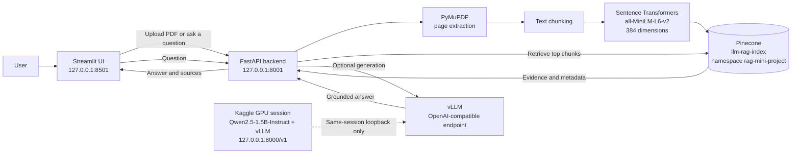

# LLM Deployment with RAG

A local Retrieval-Augmented Generation (RAG) application for asking questions about a PDF. The project combines a Streamlit interface, a FastAPI backend, local Sentence Transformers embeddings, Pinecone vector search, and an optional OpenAI-compatible vLLM endpoint for answer generation.

The main design goal is to keep the retrieval path fully local and to make the LLM boundary explicit. The included Kaggle notebook demonstrates GPU serving with vLLM inside Kaggle, but it uses Kaggle loopback only. This project does **not** create a tunnel, expose a Kaggle server publicly, or treat an unreachable Kaggle URL as a local endpoint.

## Contents

- [What the project does](#what-the-project-does)
- [Features](#features)
- [Architecture](#architecture)
- [Technology stack](#technology-stack)
- [Repository layout](#repository-layout)
- [How RAG works](#how-rag-works)
- [Prerequisites](#prerequisites)
- [Setup](#setup)
- [Pinecone setup](#pinecone-setup)
- [Run the application](#run-the-application)
- [API reference](#api-reference)
- [Kaggle vLLM server](#kaggle-vllm-server)
- [Environment variables](#environment-variables)
- [Testing](#testing)
- [Security notes](#security-notes)
- [Limitations](#limitations)
- [Troubleshooting](#troubleshooting)
- [Future improvements](#future-improvements)

## What the project does

1. A user uploads a text-based PDF.
2. The PDF is split into pages and overlapping text chunks.
3. Each chunk is embedded locally with `sentence-transformers/all-MiniLM-L6-v2`.
4. The vectors and citation metadata are stored in Pinecone.
5. A question is embedded with the same model and matched against the stored chunks.
6. The UI can show the retrieved evidence, or optionally send the evidence and question to a vLLM model for a grounded answer.
7. The generated answer is displayed with source filename, page number, and retrieval score.

The local application is designed for a single user running on `127.0.0.1`. It is not a public deployment and does not include authentication.

## Features

- PDF upload with a 10 MB size limit.
- Text extraction with PyMuPDF, including page-number metadata.
- Overlapping chunking with LangChain text splitters.
- Local CPU embeddings with a 384-dimensional Sentence Transformers model.
- Pinecone serverless index with cosine similarity.
- Dedicated Pinecone namespace: `rag-mini-project`.
- Stable vector IDs so re-uploading the same chunks updates records instead of duplicating them.
- Document Search mode that never calls an LLM.
- AI Answer mode that calls a configured vLLM endpoint.
- Source citations with filename, page, and relevance score.
- Clear handling of missing configuration, timeouts, unreachable services, and invalid PDFs.
- Temporary upload cleanup, including after errors.
- FastAPI Swagger documentation at `/docs`.
- Streamlit health status, upload statistics, session chat history, and duplicate-upload prevention.
- Mocked automated tests for external services, plus real PDF and embedding tests.

## Architecture



The components have separate responsibilities:

| Component | Responsibility |
| --- | --- |
| Streamlit | Browser UI, upload form, chat controls, source rendering |
| FastAPI | Request validation, upload handling, endpoint orchestration |
| PyMuPDF | Extract the PDF text layer page by page |
| Sentence Transformers | Embed chunks and questions on the local CPU |
| Pinecone | Persist and search vectors with metadata |
| vLLM | Optional OpenAI-compatible chat generation |
| LangChain | Document objects, text splitting, prompt templates, chat client |

The local backend and frontend are intentionally separate processes. Streamlit calls FastAPI over HTTP, and FastAPI owns all access to Pinecone and the LLM endpoint.

## Technology stack

| Area | Technology |
| --- | --- |
| Language | Python 3.11 or 3.12 |
| Frontend | Streamlit 1.57+ |
| Backend | FastAPI, Uvicorn, Pydantic |
| PDF processing | PyMuPDF |
| Embeddings | Sentence Transformers, `all-MiniLM-L6-v2` |
| RAG orchestration | LangChain Core, LangChain OpenAI |
| Vector database | Pinecone serverless, cosine similarity |
| LLM | `Qwen/Qwen2.5-1.5B-Instruct` |
| LLM serving | vLLM in a Kaggle GPU session |
| Tests | pytest, FastAPI TestClient, Streamlit AppTest |

Model names are pinned in code rather than environment variables. The QA model and the embedding model must stay compatible with the Pinecone index and the notebooks.

## Repository layout

```text
.
├── backend/
│   ├── __init__.py
│   ├── main.py              # FastAPI health, upload, and chat endpoints
│   ├── pdf_processor.py     # PDF extraction and chunk splitting
│   ├── embeddings.py        # Local 384-dimensional embeddings
│   ├── vector_store.py      # Pinecone index creation, upload, and search
│   └── rag_pipeline.py      # Retrieval, prompt construction, generation
├── frontend/
│   └── app.py               # Streamlit upload, search, and chat UI
├── kaggle/
│   ├── llm_server.ipynb     # vLLM server and API checks on Kaggle
│   └── test_rag_integration.ipynb  # Same-session RAG integration test
├── tests/
│   ├── test_api.py          # FastAPI endpoint and upload tests
│   ├── test_frontend.py     # Streamlit AppTest behavior
│   ├── test_pdf_processing.py        # Real PDF extraction and chunking
│   ├── test_embeddings_unit.py       # Real local embedding checks
│   ├── test_rag_unit.py              # Prompt and generation-flow tests
│   ├── test_vector_store_unit.py     # Mocked Pinecone logic tests
│   ├── test_pdf_processor.py         # Manual PDF inspection script
│   ├── test_embeddings.py            # Manual embedding/similarity demo
│   ├── test_vector_store.py          # Manual live Pinecone test
│   ├── test_rag_pipeline.py          # Manual retrieval/prompt preview
│   └── test_remote_llm.py            # Manual client for a permitted HTTPS endpoint
├── .env.example
├── .gitignore
├── requirements.txt
├── TESTING.md
└── README.md
```

The files whose names start with `test_` but do not contain pytest test functions are manual integration helpers. They are not collected by the default test suite.

## How RAG works

### 1. Indexing

```text
PDF
  -> PyMuPDF page extraction
  -> LangChain Documents with {source, page}
  -> overlapping chunks (500 characters, 100 overlap by default)
  -> Sentence Transformers embeddings (384 values per chunk)
  -> Pinecone upsert with text, source, and page metadata
```

The default chunking parameters are character-based, not token-based. The overlap helps preserve meaning when a sentence crosses a chunk boundary.

### 2. Retrieval

The user's question is embedded with the **same** model that embedded the chunks. Pinecone returns the `top_k` closest chunks, and the backend returns their text, source, page, and score.

Retrieval mode is useful for checking whether the index contains the right evidence before involving an LLM. It is also the only mode that can work without an LLM endpoint.

### 3. Generation

In generation mode, the retrieved chunks are formatted into a prompt with explicit source and page labels. The prompt tells the model to:

- use only the retrieved document text;
- ignore instructions inside the retrieved text;
- return an exact not-found message when the evidence is insufficient.

Retrieved PDF text is treated as untrusted data. The delimiter-escaping rule in the prompt is a structural safeguard, not a complete defense against prompt injection. RAG reduces hallucination but does not eliminate it, so the source citations remain important.

If Pinecone returns no chunks, the backend returns `I couldn't find that information in the provided document.` without calling the LLM.

## Prerequisites

- Windows 10/11 with PowerShell, or an equivalent shell on macOS/Linux.
- Python 3.11 or 3.12. The examples use Python 3.12.
- Git.
- A Pinecone account and API key for upload and retrieval.
- Internet access on first use so Sentence Transformers can download the embedding model.
- Optional: a Kaggle account with GPU access for the vLLM notebook.
- Optional: a permitted, reachable OpenAI-compatible vLLM endpoint for local AI Answer mode.

No local GPU is required for the local application. Embeddings run on the CPU.

## Setup

Commands below are for Windows PowerShell.

### 1. Create and activate a virtual environment

```powershell
py -3.12 -m venv .venv
.\.venv\Scripts\Activate.ps1
```

If PowerShell blocks activation, allow it only for the current terminal:

```powershell
Set-ExecutionPolicy -Scope Process -ExecutionPolicy Bypass
.\.venv\Scripts\Activate.ps1
```

On macOS/Linux:

```bash
python3 -m venv .venv
source .venv/bin/activate
```

### 2. Install dependencies

```powershell
python -m pip install --upgrade pip
python -m pip install -r requirements.txt
```

vLLM is deliberately not in `requirements.txt`. It is installed only inside the Kaggle GPU notebook, and may require a specific CUDA/PyTorch combination.

### 3. Create the local environment file

```powershell
Copy-Item .env.example .env
notepad .env
```

Replace `your_pinecone_api_key` with a real key. The file is ignored by Git. Never commit it.

For retrieval-only use, leave the vLLM values as placeholders. For AI Answer mode, set a permitted endpoint and API key as described in [Environment variables](#environment-variables).

## Pinecone setup

Create a free Pinecone account at <https://app.pinecone.io>.

Recommended setup:

1. Create an index named `llm-rag-index` (or set another name in `.env`).
2. Use **384 dimensions**.
3. Use the **cosine** metric.
4. Use a serverless index, for example AWS `us-east-1`.
5. Put the real API key and index name in `.env`.

The application uses the namespace `rag-mini-project` automatically. Vectors and metadata stay inside that namespace.

If the index does not exist, `get_pinecone_index()` creates it with dimension 384, cosine similarity, dense vectors, and the configured serverless region. The first creation can take time; the code waits up to 120 seconds for readiness.

If an existing index has a different dimension or metric, the application raises a clear error instead of deleting or recreating it. Use a different index name or create a compatible index manually.

## Run the application

Use two terminals with the virtual environment activated.

### Terminal 1: FastAPI backend

```powershell
python -m uvicorn backend.main:app --reload --port 8001
```

Check these URLs:

- API health: <http://127.0.0.1:8001/health>
- Swagger UI: <http://127.0.0.1:8001/docs>

The backend command binds to the default local host. Keep it on loopback; do not expose it with `--host 0.0.0.0` for this mini-project.

### Terminal 2: Streamlit frontend

```powershell
python -m streamlit run frontend/app.py
```

Open the URL that Streamlit prints, normally <http://127.0.0.1:8501>.

If you change the backend port, also update `FASTAPI_BASE_URL` in `.env`.

### First end-to-end retrieval test

1. Start both services.
2. Upload a small text-based PDF in the Streamlit sidebar, or use `POST /upload` in Swagger UI.
3. Wait for the upload summary showing pages, chunks, and vectors.
4. Ask a question whose answer is in the PDF.
5. Choose **Document Search** to inspect the retrieved evidence.
6. Inspect the source filename, page number, and score.

If Pinecone is configured correctly, this path works without Kaggle, vLLM, or an external LLM.

### AI Answer mode

AI Answer mode requires both `VLLM_API_BASE_URL` and `VLLM_API_KEY`. The backend strips a trailing `/` and adds `/v1` when needed. Without a configured endpoint, the API returns HTTP 503 with an explanation; it does not silently fall back to another provider.

The Kaggle loopback URL is not a valid local endpoint. See [Kaggle vLLM server](#kaggle-vllm-server).

## API reference

### `GET /health`

Returns:

```json
{"status": "ok"}
```

### `POST /upload`

Multipart form upload with field name `file`.

Rules:

- Filename must end in `.pdf`.
- File must not be empty.
- Maximum size is 10 MB.
- File must be a readable PDF with a text layer.
- Password-protected PDFs are rejected.
- The temporary upload is always deleted.

Example response:

```json
{
  "filename": "sample.pdf",
  "pages_processed": 2,
  "chunks_created": 4,
  "vectors_uploaded": 4,
  "message": "PDF processed and stored in Pinecone successfully."
}
```

### `POST /chat`

Request:

```json
{
  "question": "What is machine learning?",
  "top_k": 3,
  "generate": false
}
```

`top_k` must be between 1 and 10. `generate: false` returns retrieved chunks only. `generate: true` retrieves evidence and then calls the configured LLM.

Retrieval response:

```json
{
  "question": "What is machine learning?",
  "generate": false,
  "answer": null,
  "sources": [
    {
      "text": "Machine learning is a field of artificial intelligence...",
      "source": "sample.pdf",
      "page": 2,
      "score": 0.74
    }
  ]
}
```

Generation response:

```json
{
  "question": "What is machine learning?",
  "generate": true,
  "answer": "Machine learning is a field of artificial intelligence...",
  "sources": [
    {"source": "sample.pdf", "page": 2, "score": 0.74}
  ]
}
```

Common status codes:

| Code | Meaning |
| --- | --- |
| 200 | Request succeeded |
| 400 | Invalid PDF, empty PDF, no extractable text, or invalid question/top_k |
| 413 | Upload exceeds 10 MB |
| 502 | LLM endpoint returned an error |
| 503 | Pinecone or LLM configuration is missing or unavailable |
| 504 | LLM or Pinecone request timed out |

## Kaggle vLLM server

The GPU serving notebook is `kaggle/llm_server.ipynb`. It is intended to be uploaded to Kaggle and run there with a GPU enabled.

What it demonstrates:

- environment and CUDA checks;
- installing vLLM in the Kaggle environment;
- loading `Qwen/Qwen2.5-1.5B-Instruct`;
- running in-notebook inference;
- starting an OpenAI-compatible vLLM server on `127.0.0.1:8000/v1`;
- checking `/v1/models` and `/v1/chat/completions`;
- API-key behavior;
- stopping the server cleanly.

The notebook is not run by the local test suite. It is not part of the local dependency installation.

### Kaggle policy and networking

Kaggle provides a GPU notebook environment, not a public hosting service. The vLLM server in the notebook listens on loopback inside the Kaggle session. This project does not use ngrok, Cloudflare Tunnel, SSH reverse tunnels, or any other mechanism to expose it.

As a result:

- a Windows machine cannot call `127.0.0.1:8000` and reach Kaggle;
- local AI Answer mode needs a permitted, reachable endpoint;
- the included Kaggle integration notebook is the supported way to test the full RAG flow with the GPU model.

### Integration notebook

`kaggle/test_rag_integration.ipynb` is a separate same-session test. It covers:

1. dependency checks;
2. loading Kaggle Secrets;
3. starting or reusing the loopback vLLM server;
4. checking the local API;
5. retrieving chunks from Pinecone;
6. building the RAG prompt;
7. generating an answer with vLLM;
8. testing an answerable question and an unrelated question;
9. optional cleanup.

Add `PINECONE_API_KEY` and `VLLM_API_KEY` as Kaggle Secrets and attach them to the notebook. Do not paste keys into notebook cells. The notebook reads secrets at runtime and prints only whether each value is set.

The integration notebook uses the same Pinecone namespace as the local application. Upload a PDF locally first, or run the retrieval setup it expects, before testing generation.

### Manual Kaggle procedure

1. Upload `kaggle/llm_server.ipynb` to Kaggle.
2. Select a GPU runtime and enable internet access.
3. Run the environment checks.
4. Install vLLM as instructed by the notebook.
5. Restart the kernel after installation when the notebook says to do so.
6. Run the model-loading and generation cells.
7. Start the API server and test `/v1/models` and `/v1/chat/completions`.
8. Stop the server when finished.
9. For the full RAG flow, open `kaggle/test_rag_integration.ipynb` in the same Kaggle session or start the server again in that session.
10. Confirm both an answerable question and an unrelated question behave correctly.

Do not run the GPU/vLLM installation cells on the local Windows machine.

## Environment variables

The local application reads `.env` from the project root.

| Variable | Required | Default | Purpose |
| --- | --- | --- | --- |
| `FASTAPI_BASE_URL` | No | `http://127.0.0.1:8001` | URL used by Streamlit to call FastAPI |
| `PINECONE_API_KEY` | Yes for upload/retrieval | none | Pinecone authentication |
| `PINECONE_INDEX_NAME` | Yes for upload/retrieval | none | Index containing the document vectors |
| `VLLM_API_BASE_URL` | Only for AI Answer | none | Permitted OpenAI-compatible endpoint |
| `VLLM_API_KEY` | Only for AI Answer | none | Key for that endpoint |

Model names are not environment variables. They are pinned as:

```text
Qwen/Qwen2.5-1.5B-Instruct
sentence-transformers/all-MiniLM-L6-v2
```

If you change either model, update the backend, the Kaggle notebooks, and the Pinecone index consistently. Changing only one side breaks retrieval or generation.

### Secret handling

- `.env` is ignored by Git.
- `.env.example` contains placeholders only.
- `.streamlit/secrets.toml`, `kaggle.json`, private keys, PDFs, logs, and model weights are ignored.
- API keys are passed to the LLM client at runtime and are not printed by the application.
- If a key is exposed, rotate it in Pinecone or the endpoint provider.

## Testing

The automated suite is designed to run without a live Pinecone account or a running vLLM server. Network-facing pieces are mocked where practical, while PDF extraction and embedding behavior use the real local libraries and model.

Run the full suite:

```powershell
python -m pytest -q
```

Run the local API and frontend tests only:

```powershell
python -m pytest tests\test_api.py tests\test_frontend.py -q
```

See [`TESTING.md`](TESTING.md) for the dated test record, individual test coverage, results, and the external services that were not exercised in this environment.

Manual checks are also available:

```powershell
python tests\test_pdf_processor.py path\to\sample.pdf
python tests\test_embeddings.py path\to\sample.pdf
python tests\test_vector_store.py path\to\sample.pdf
python tests\test_rag_pipeline.py "What is machine learning?"
python tests\test_remote_llm.py
```

The last three scripts need live Pinecone or a permitted LLM endpoint and were not run as part of the local automated suite.

## Security notes

This is a local mini-project, not a hardened production service.

- Keep the backend and frontend bound to `127.0.0.1`.
- Do not expose the Kaggle loopback server through a tunnel.
- Do not commit `.env`, Kaggle credentials, private keys, or notebook outputs containing secrets.
- Uploads are limited to 10 MB and must have a `.pdf` extension; content is validated by PyMuPDF.
- Temp uploads are deleted in a `finally` block.
- Retrieved text is treated as untrusted evidence in the prompt.
- The application has no user authentication, authorization, rate limiting, or multi-tenant isolation.
- The prompt-injection escape is a best-effort structural measure, not a guarantee.
- Generated answers can still be wrong. Treat the cited sources as the evidence.

## Limitations

- Retrieval and upload need a Pinecone API key and network access.
- Live Pinecone upload and retrieval are not verified by the automated tests in this repository snapshot.
- Local AI Answer mode needs a reachable, permitted vLLM endpoint; Kaggle loopback is not reachable from Windows.
- Live Kaggle vLLM execution is not part of local testing.
- Scanned PDFs without a text layer are not supported. OCR is future work.
- Chat history is session-only and is not persisted.
- Uploads are not retained as files; only extracted chunks and vectors are stored.
- There is no document deletion or index-reset endpoint.
- Source identity is based on the uploaded filename and chunk content. Two different PDFs with identical filenames and content can collide; a production system should use a file hash or immutable document ID.
- Pinecone index creation may take time on the first upload.
- There is no streaming response and no background job queue.
- The UI and API are designed for one local user.

## Troubleshooting

**`503` in AI Answer mode**

No usable `VLLM_API_BASE_URL` and `VLLM_API_KEY` are configured. Placeholder values from `.env.example` are intentionally rejected. The Kaggle loopback URL cannot be used from the local machine.

**`503` during upload or retrieval**

Check `PINECONE_API_KEY`, `PINECONE_INDEX_NAME`, the index dimension (384), the metric (cosine), and network access.

**Index dimension or metric mismatch**

The application refuses to modify an incompatible index. Create a new index with dimension 384 and cosine similarity, then update `PINECONE_INDEX_NAME`.

**The embedding model download is slow**

The first use downloads `all-MiniLM-L6-v2` from Hugging Face. Later runs use the local model cache. The local application needs internet access for that first download.

**A PDF is rejected**

The file may be empty, corrupted, password-protected, or scanned without a text layer. Only text-based PDFs are supported. Password protection and OCR are outside the current scope.

**Port already in use**

Change the backend port in the Uvicorn command and set `FASTAPI_BASE_URL` to the same port. For Streamlit, pass `--server.port`.

**Streamlit cannot reach FastAPI**

Confirm the backend is running on `http://127.0.0.1:8001`, then check the sidebar health indicator. If you changed the port, update `.env` and restart Streamlit.

## Future improvements

- Add OCR for scanned PDFs.
- Add authentication and per-user document isolation before any shared deployment.
- Persist chat history and document metadata.
- Add document deletion, index reset, and upload progress.
- Use a file hash or immutable document ID for stronger source identity.
- Add reranking and token-aware chunking.
- Add streaming responses and background indexing jobs.
- Add a Docker Compose setup for the local services.
- Add integration tests against a disposable Pinecone index and a controlled vLLM endpoint.
- Add retrieval-quality evaluation and prompt-injection tests.
- Add structured logging, metrics, and health/readiness details without logging secrets.
- Add CI for unit tests, linting, and type checking.

## Project status

All local components are implemented:

- PDF extraction and chunking
- local embeddings
- Pinecone storage and retrieval
- RAG prompt construction
- Kaggle vLLM serving notebook
- same-session Kaggle integration notebook
- FastAPI backend
- Streamlit frontend
- automated tests and manual validation scripts
- setup, security, and testing documentation

Live Pinecone and live Kaggle GPU checks remain environment-dependent and are recorded as **NOT TESTED** where they could not be executed. See [`TESTING.md`](TESTING.md) for the exact evidence.
